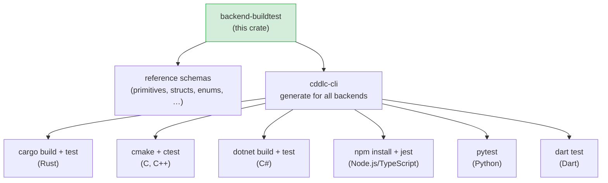

# backend-buildtest

Validates that `cddlc`-generated code actually compiles and tests pass with real language
toolchains.  It contains a set of reference CDDL schemas and a Rust test harness that runs
`cddlc` for each backend, then invokes the backend's native build tool (`cargo`, `cmake`,
`dotnet`, `npm`, `python -m pytest`, `dart test`) on the generated output.

## Position in the pipeline



## Reference schemas

The `schemas/` directory contains CDDL files that collectively exercise the full range of
`cddlc` features across all backends:

| Schema | Purpose |
|---|---|
| `primitives.cddl` | All primitive types: bool, uint, int, float32, float64, tstr, bstr |
| `structs.cddl` | Named map structs with required and optional fields |
| `enums.cddl` | String enums, integer enums, and mixed-type choices |
| `arrays.cddl` | Fixed-length and unbounded arrays; `@capacity` pragma |
| `aliases.cddl` | Type aliases with `.size` and `.range` constraints |
| `tagged.cddl` | CBOR tag `#6.N(T)` — tag emission and verification |
| `iot_sensor.cddl` | Realistic IoT device schema combining all features |
| `inline-enum-in-group-after-comment.cddl` | Edge case: inline enum variant inside a group following a comment |

## Running the build tests

The build tests are marked `#[ignore]` and are **not** run by default `cargo test`.
They require the relevant toolchains to be installed on the host machine.

```bash
# Run all build validation tests (requires all toolchains):
cargo test -p backend-buildtest -- --ignored --nocapture

# Run for a single backend:
cargo test -p backend-buildtest test_build_rust   -- --ignored --nocapture
cargo test -p backend-buildtest test_build_c      -- --ignored --nocapture
cargo test -p backend-buildtest test_build_cpp    -- --ignored --nocapture
cargo test -p backend-buildtest test_build_csharp -- --ignored --nocapture
cargo test -p backend-buildtest test_build_nodejs -- --ignored --nocapture
cargo test -p backend-buildtest test_build_python -- --ignored --nocapture
cargo test -p backend-buildtest test_build_dart   -- --ignored --nocapture
```

### Toolchain requirements

| Backend | Required tools |
|---|---|
| Rust | `cargo` (any recent stable) |
| C | `cmake`, a C compiler (`gcc` or `clang`) |
| C++ | `cmake`, a C++17-capable compiler |
| C# | `dotnet` SDK 8+ |
| Node.js | `node` 18+, `npm` |
| Python | `python3` 3.10+, `pip`, `pytest` |
| Dart | `dart` SDK 3+ (or `flutter`) |

## How the tests work

Each test function:

1. Locates `cddlc` (built binary or `cargo run`).
2. Calls `cddlc <schema> --lang <lang> -o <tmpdir>` for each reference schema.
3. Runs the native build/test tool in the generated directory.
4. Returns `BuildOutcome::Pass`, `BuildOutcome::Fail(output)`, or
   `BuildOutcome::ToolchainMissing`.

`ToolchainMissing` is treated as a skip (not a test failure), so the suite can run on a
developer machine that only has some toolchains installed.

## Internals

```rust
pub enum BuildOutcome {
    Pass,
    Fail(String),          // stderr / stdout from the failed build
    ToolchainMissing,      // required tool not found in PATH
}

pub fn find_tool(name: &str) -> Option<PathBuf>;    // PATH search
```

The `find_tool` helper checks `PATH` for the required binary before attempting a build,
allowing graceful skip on CI runners that don't have all toolchains.

## Known gaps and future enhancements

- **`#[ignore]` by default**: build tests do not run in standard CI (`cargo test` alone).
  A CI job matrix with separate runners for each toolchain would provide continuous build
  validation.
- **git submodule friction**: `backend-buildtest` is a git submodule (the `schemas/`
  directory is checked out from a separate repository).  Fresh clones require
  `git submodule update --init` — a step that is easy to forget.
- **No Windows CI coverage**: the build scripts assume Unix-style paths and tool invocations;
  Windows support (MSVC, PowerShell paths) is not verified.
- **Single schema per test**: each backend test runs all reference schemas in a single
  invocation; a failure in one schema aborts the rest.  Separating schemas into individual
  test cases would give finer-grained failure reporting.
- **No performance benchmarks**: the build tests verify correctness but do not measure
  compile time or binary size of the generated code.
- **No regression baseline**: there is no stored "known good" build output to diff against;
  a schema change that silently alters generated code structure would not be caught unless
  the build itself fails.
- **Dart backend not in default schema set**: the Dart backend is newer and may not be
  exercised by all reference schemas in the current submodule state.

## License

MIT OR Apache-2.0
